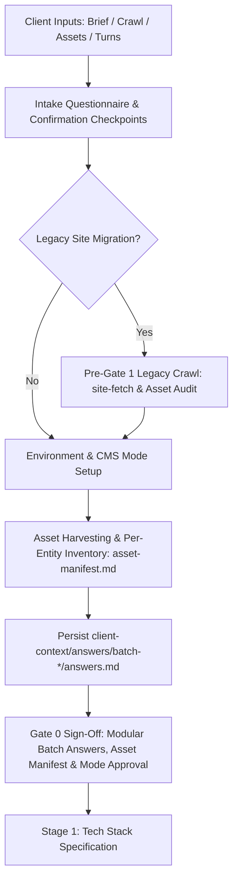

# Stage 0: Intake Check & Project Brief Runbook

## Overview & Role in Pipeline

Stage 0 is the foundation of the 9-stage human-gated website development lifecycle. In this stage, the agent ingests client requirements across multiple sources (brief notes, legacy crawl, uploaded assets, and interactive turns), establishes project scope, confirms the **Technical Project Name / Vercel Slug**, executes a comprehensive visual asset audit and harvesting pipeline, configures the environment contract (`.env.example`), and drafts the foundational project brief before proceeding to technical architecture in Stage 1.



---

## Technical Project Name & Vercel Slug Propagation

In Batch 01, the agent confirms the **Technical Project Name / Slug** (e.g. `minit-charger`, `lumina-portfolio`, `apex-saas`). This identifier must be used consistently:
1. **Gate 2 Variations:** Every design variation directory and review portal must use this slug (e.g. `project-docs/client-review/gate-2-design-theory/<project-slug>-v1/index.html`).
2. **Next.js Package Name:** Stored as `"name": "<project-slug>"` in `site/package.json`.
3. **Vercel Project Setup:** Used when creating or linking the Vercel project (`vercel link --project <project-slug>`) for public preview and staging reviews. Localhost forwarding is strictly forbidden.

---

## Pre-Gate 1 Legacy Website Archiving & Asset Salvage

If the project involves redesigning, replacing, or migrating an existing website, the legacy site **MUST** be archived and cataloged **before Gate 1**. This ensures URL structures, metadata, copy, and existing page layouts are preserved for 301 redirect mapping (Stage 4) and content migration (Stage 5).

Execute the companion `site-fetch` utility:
```bash
node skills/create-nww-website/scripts/site-fetch/index.js --url "https://example.com" --out previous-site --mode migration
```

The crawler captures:
- `manifest.json`: Full page catalog, HTTP status codes, titles, and meta descriptions.
- `sitemap-legacy.xml`: Legacy route index.
- `<slug>/index.html`: Complete raw HTML markup.
- `<slug>/content.md`: Clean, readability-extracted Markdown content.
- `<slug>/screenshot.png`: High-resolution full-page visual capture.

---

## Asset Harvesting & Generation System (Batch 04)

Visual assets are audited and classified before design or technical architecture:
1. **Legacy Asset Audit:** Catalog logos, product photos, project deliverables, and team headshots from `previous-site/`.
2. **Reuse Permission & Resolution Check:** Client explicitly approves which legacy assets carry forward. Assets under 1200px desktop width are flagged for replacement.
3. **Per-Entity Asset Intake:** Collect required high-resolution visual assets for **each** product, project/case study, service, and team member.
4. **Stock & Generation Strategy:** Enforce stock image count ceiling (default: 20 images) and generate `client-context/asset-manifest.md`.

---

## Questionnaire & Client Discovery Batches

Consult [client-questionnaire.md](client-questionnaire.md) for master orchestration. Present questions in 1-turn batches (5–7 questions per turn) using the modular guides:

1. [Batch 01: Core Identity, Project Slug & Scope](batch-01-core-identity/questionnaire.md) (Q1a–Q8)
2. [Batch 02: Branding, Design Direction & Motion Tier](batch-02-branding-motion/questionnaire.md) (Q9–Q15: `disabled`, `low`, `medium`, `high`, `max`, `ultra`)
3. [Batch 03: Sitemap, Navigation & Verbatim Copywriting](batch-03-sitemap-copy/questionnaire.md) (Q16–Q21)
4. [Batch 04: Asset Harvesting, Inventory & Generation System](batch-04-asset-harvesting-generation/questionnaire.md) (Q22a–Q24d)
5. [Batch 05: Type-Specific Architectural Routing](batch-05-type-specific-routing/questionnaire.md) (E-commerce, Portfolio, SaaS, Booking, Blog, Corporate)
6. [Batch 06: Legacy Website Migration & Content Carry-Forward](batch-06-legacy-site-migration/questionnaire.md) (Q26a–Q26e, if migration)
7. [Batch 07: Technical SEO, Domain, Analytics & Governance](batch-07-seo-analytics-governance/questionnaire.md) (Q27–Q36)

Store confirmed client responses in `client-context/answers/batch-[number]-[batch-name]/answers.md` and compiled assets in `client-context/asset-manifest.md`.

---

## Environment & CMS Mode Configuration

Generate `site/.env.example` reflecting the confirmed CMS mode:

### Mode A: Markdown-Only (Zero External CMS)
No CMS API keys required. All content is stored in local static Markdown files under `site/content/`.
```env
NEXT_PUBLIC_SITE_URL=https://example.com
```

### Mode B: API-Headless (NWW CMS Integration)
Requires tenant verification and API keys:
```env
NEXT_PUBLIC_SITE_URL=https://example.com
NWW_CMS_API_URL=https://api.netwebworks.com
NWW_TENANT_ID=tenant_abc123
NWW_API_BEARER_TOKEN=bearer_secret_token
REVALIDATION_SECRET=reval_token_xyz
```

---

## Deliverables Checklist for Gate 0

Before requesting Gate 0 approval, verify that all required assets exist:
- [ ] `client-context/answers/batch-*/answers.md`: Documented answers to each intake batch with confirmed project slug.
- [ ] `client-context/asset-manifest.md`: Audited inventory of legacy, per-entity, stock, and generated assets.
- [ ] `project-docs/client-brief.md`: Structured project brief synthesizing goals, target audience, and brand voice.
- [ ] `project-docs/router-state.md`: Initialized stage tracker (`stage: 0`, `gate_0: pending`).
- [ ] `previous-site/`: Crawled legacy site assets (if migration).
- [ ] `.env.example`: Configured environment variable contract in root and `site/`.

---

## Gate 0 Approval Protocol

1. Present the project brief, asset manifest summary, selected CMS mode, and motion tier to the user/client.
2. Halt execution and explicitly prompt:
   > *"Stage 0 Intake is complete. Please review the confirmed batch answers (`client-context/answers/batch-*/answers.md`), asset manifest (`client-context/asset-manifest.md`), confirmed CMS mode, and motion tier. Respond with 'approved' to proceed to Stage 1 (Tech Stack)."*
3. Update `project-docs/router-state.md` upon explicit confirmation.

---

## References

- [Master Client Discovery Questionnaire](client-questionnaire.md) — Master intake index and routing guide.
- [Pipeline Stages & State Machine](pipeline-stages.md) — Master 9-stage state machine and routing rules.

