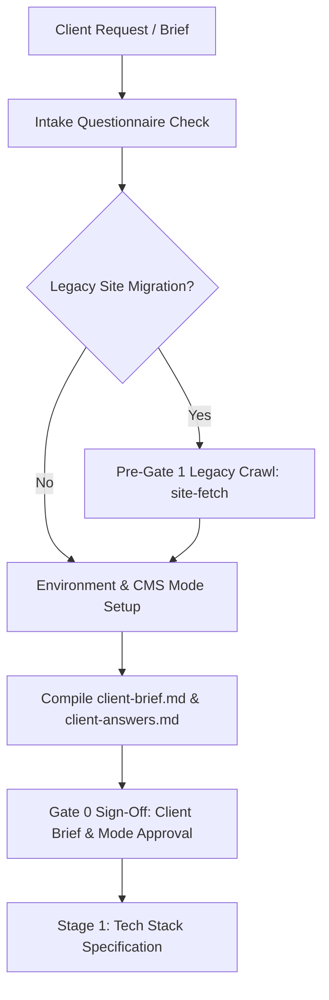

# Stage 0: Intake Check & Project Brief Runbook

## Overview & Role in Pipeline

Stage 0 is the foundation of the 9-stage human-gated website development lifecycle. In this stage, the agent collects client requirements, establishes project scope, crawls any legacy website for migration continuity, configures the environment contract (`.env.example`), and drafts the foundational project brief before proceeding to technical architecture in Stage 1.



---

## Pre-Gate 1 Legacy Website Archiving

If the project involves redesigning, replacing, or migrating an existing website, the legacy site **MUST** be archived and cataloged **before Gate 1**. This ensures URL structures, metadata, copy, and existing page layouts are preserved for 301 redirect mapping (Stage 4) and content migration (Stage 5).

Execute the companion `site-fetch` utility:
```bash
node skills/create-nww-website/scripts/site-fetch/index.js --url "https://example.com" --output previous-site/ --crawl --max-pages 50
```

The crawler captures:
- `manifest.json`: Full page catalog, HTTP status codes, titles, and meta descriptions.
- `sitemap-legacy.xml`: Legacy route index.
- `<slug>/index.html`: Complete raw HTML markup.
- `<slug>/content.md`: Clean, readability-extracted Markdown content.
- `<slug>/screenshot.png`: High-resolution full-page visual capture.

---

## Questionnaire & Client Discovery

Consult [client-questionnaire.md](client-questionnaire.md) for the complete 7-batch questionnaire. Check all client inputs against the questionnaire coverage matrix:
1. **Business Profile & Brand Identity** (Q1–Q4)
2. **Project Scope & Architecture** (Q5–Q8)
3. **Design Direction & Visual Identity** (Q9–Q13)
4. **Motion & Interaction Tier** (Q14: `disabled`, `low`, `medium`, `high`, `max`, `ultra`)
5. **SEO & Analytics Foundations** (Q15–Q18)
6. **Technical & CMS Preferences** (Q19–Q22: `markdown-only` vs `api-headless`)
7. **Timeline & Operational Constraints** (Q23–Q25)

Store confirmed client responses in `client-context/client-answers.md`.

---

## Environment & CMS Mode Configuration

Generate `site/.env.example` reflecting the confirmed CMS mode:

### Mode A: Markdown-Only (Zero External CMS)
No CMS API keys required. All content is stored in local static Markdown files under `site/content/`.
```env
NEXT_PUBLIC_SITE_URL=https://example.com
```

### Mode B: API-Headless (NWW CMS Integration)
Requires tenant verification and API keys:
```env
NEXT_PUBLIC_SITE_URL=https://example.com
NWW_CMS_API_URL=https://api.netwebworks.com
NWW_TENANT_ID=tenant_abc123
NWW_API_BEARER_TOKEN=bearer_secret_token
REVALIDATION_SECRET=reval_token_xyz
```

---

## Deliverables Checklist for Gate 0

Before requesting Gate 0 approval, verify that all required assets exist:
- [ ] `client-context/client-answers.md`: Documented answers to the intake questionnaire.
- [ ] `project-docs/client-brief.md`: Structured project brief synthesizing goals, target audience, and brand voice.
- [ ] `project-docs/router-state.md`: Initialized stage tracker (`stage: 0`, `gate_0: pending`).
- [ ] `previous-site/`: Crawled legacy site assets (if migration).
- [ ] `.env.example`: Configured environment variable contract.

---

## Gate 0 Approval Protocol

1. Present the project brief, selected CMS mode, and motion tier to the user/client.
2. Halt execution and explicitly prompt:
   > *"Stage 0 Intake is complete. Please review the project brief, confirmed CMS mode, and motion tier. Respond with 'approved' to proceed to Stage 1 (Tech Stack)."*
3. Update `project-docs/router-state.md` upon explicit confirmation.

---

## References

- [Client Discovery Questionnaire](client-questionnaire.md) — 7-batch structured intake questionnaire.
- [Pipeline Stages & State Machine](pipeline-stages.md) — Master 9-stage state machine and routing rules.
