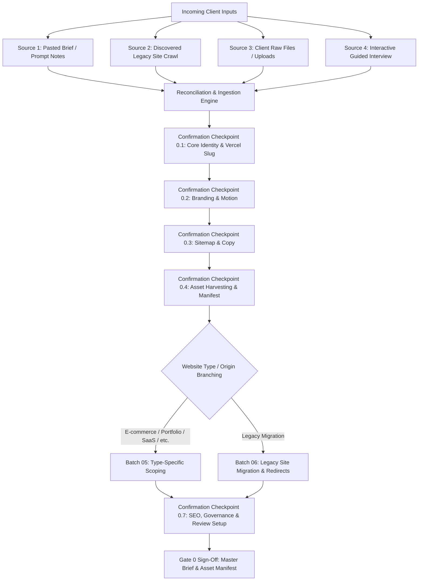

# Master Client Discovery Questionnaire & Intake Architecture

**Read this reference when:** The skill is activated and needs to execute the intake interview, resume an existing brief, prefill from user notes, crawl a legacy website, harvest/generate visual assets, or compile modular batch answer files in `client-context/answers/batch-*/answers.md` and `client-context/asset-manifest.md` for Gate 0 approval.

---

## 1. Multi-Source Client Input Architecture & Confirmation Stages

Client requirements and context arrive from multiple complementary sources. The agent must ingest, reconcile, and confirm inputs through explicit confirmation stages before advancing to Stage 1.



### The 4 Input Sources & Confirmation Rules

1. **Source 1: Pasted Brief / User Prompt Notes:**
   - If the user provides a brief or notes in their opening prompt, extract all known answers into memory.
   - Present an ingestion recap: *"Successfully parsed [N] answers from your notes."*
   - Never re-ask questions already clearly answered. Present ONLY the first batch containing unanswered questions.
2. **Source 2: Legacy Website Crawl (`previous-site/`):**
   - If `build_origin == migration` or a legacy URL is provided, crawl the old site before Gate 1:
     `node skills/create-nww-website/scripts/site-fetch/index.js --url <legacy-url> --out previous-site --mode migration`
   - Audit crawled routes (`manifest.json`), media files, and legacy sitemap.
   - Present discovered resources to the client for disposition in Batch 04 and Batch 06.
3. **Source 3: Client Raw Files & Uploaded Assets:**
   - Inspect `client-context/assets/`, `client-context/raw/`, and `public/` for logos, diagrams, or product photos.
   - Verify file types and resolution status in Batch 04.
4. **Source 4: Interactive Dialogue Pacing:**
   - Present exactly one batch (5 to 7 questions) per turn.
   - Wait for user response before presenting the subsequent batch.
   - For vague or contradictory replies, ask a concise follow-up question. Never fabricate required answers.
   - If an optional question receives "I don't know" or "decide later", assign the documented project default.
5. **Secret Hygiene Guardrail:**
   - Never request, accept, or record secret credentials, API keys, or passwords.
   - If the user provides a secret, immediately reject it, remind them to keep credentials in `.env.local`, and record only the environment variable name (`CMS_SITE_KEY`, `SERVER_URL`, `REVALIDATE_SECRET`, `PIXABAY_API_KEY`).

---

## 2. Technical Project Name & Vercel Slug Propagation

During **Batch 01 (Q1b)**, the agent confirms the **Technical Project Name / Slug** (e.g., `minit-charger`, `lumina-portfolio`, `apex-saas`).

This project slug is strictly propagated across downstream pipeline stages:
1. **Gate 2 Design Variations:**
   - Every design variation folder and review page must use this project slug:
     `project-docs/client-review/gate-2-design-theory/<project-slug>-v1/index.html`
     `project-docs/client-review/gate-2-design-theory/<project-slug>-v2/index.html`
     `project-docs/client-review/gate-2-design-theory/<project-slug>-v3/index.html`
   - The review hub title and metadata prominently display this project name.
2. **Stage 6 Next.js Scaffolding:**
   - Used as the official `name` property in `site/package.json`:
     `"name": "<project-slug>"`
3. **Vercel Project Setup & Public Review Linkage:**
   - Used as the explicit project name when creating or linking the Vercel project:
     `vercel link --project <project-slug>`
   - Localhost URLs are strictly forbidden for client forwarding. All client review milestones require live public deployments (GitHub Pages for Gate 2 variations; Vercel for Next.js preview and production).

---

## 3. Modular Batch Directory Index

The intake questionnaire is split into 7 modular, deep-dive reference documents:

| Batch Directory | Focus & Scope | Key Routing & Downstream Impact | Reference Runbook |
|---|---|---|:---:|
| `batch-01-core-identity` | Business identity, **Project Slug / Vercel Name**, offering, audience, primary CTA, website type, build origin, CMS mode, timeline | Sets architectural path, locks Vercel slug, triggers dynamic routing | [batch-01 questionnaire](batch-01-core-identity/questionnaire.md) |
| `batch-02-branding-motion` | Brand vectors, color tokens, typography, brand scale, design references to crawl, anti-patterns, variation count (2–4), **GSAP animation tier** (`disabled` to `ultra`) | Drives Gate 2 variation generation (HTML + Tailwind + jQuery) and GSAP library loading rules | [batch-02 questionnaire](batch-02-branding-motion/questionnaire.md) |
| `batch-03-sitemap-copy` | Core launch sitemap, section needs, copywriting strategy (`agency-draft`, `client-ready`, `hybrid`), voice & tone, navigation, lead capture forms | Governs Stage 3 `page-list.md` and Stage 5 verbatim copy drafting | [batch-03 questionnaire](batch-03-sitemap-copy/questionnaire.md) |
| `batch-04-asset-harvesting-generation` | **Core Asset System**: Legacy asset salvage audit, per-entity asset intake (each product, project, service, team member), resolution check, stock authorization & count ceiling, AI/graphic generation | Generates required `client-context/asset-manifest.md` and enforces image quality before design | [batch-04 questionnaire](batch-04-asset-harvesting-generation/questionnaire.md) |
| `batch-05-type-specific-routing` | Deep-dive dynamic routing for: **E-commerce**, **Portfolio**, **SaaS / Web App**, **Booking / Service**, **Blog / Publication**, and **Corporate** | Injects type-specific modules (Stripe, Calendly, Case Studies, Pricing Matrices, Taxonomies) | [batch-05 questionnaire](batch-05-type-specific-routing/questionnaire.md) |
| `batch-06-legacy-site-migration` | Legacy site migration disposition: route action (`carry-verbatim`, `rewrite`, `merge`, `retire`), content carry-forward decisions, 301 redirect map | Essential for Stage 4 301 redirects and preserving existing SEO equity | [batch-06 questionnaire](batch-06-legacy-site-migration/questionnaire.md) |
| `batch-07-seo-analytics-governance` | Search queries, market focus, production domain, GA4 ID, legal entity details, review deployment format, codebase folder, sign-off approver | Sets up `site/.env.example`, legal pages, review portals, and governance | [batch-07 questionnaire](batch-07-seo-analytics-governance/questionnaire.md) |

---

## 4. Master Deliverable: Modular Batch Answers (`client-context/answers/batch-*`)

After each questionnaire batch is completed and confirmed, the agent persists the answers directly to its dedicated file under `client-context/answers/batch-[number]-[batch-name]/answers.md`:

```
client-context/
├── answers/
│   ├── batch-01-core-identity/
│   │   └── answers.md
│   ├── batch-02-branding-motion/
│   │   └── answers.md
│   ├── batch-03-sitemap-copy/
│   │   └── answers.md
│   ├── batch-04-asset-harvesting-generation/
│   │   └── answers.md
│   ├── batch-05-type-specific-routing/
│   │   └── answers.md
│   ├── batch-06-legacy-site-migration/       # If migration
│   │   └── answers.md
│   └── batch-07-seo-analytics-governance/
│       └── answers.md
└── asset-manifest.md
```

### Batch Answers Templates

#### `client-context/answers/batch-01-core-identity/answers.md`
```markdown
# Batch 01 Answers: Core Identity & Project Scope

- **Business Name:** [Business Display Name]
- **Technical Project Name / Slug:** [project-slug]
- **Vercel Project Identifier:** [project-slug]
- **Core Offering:** [1-2 sentence offering summary]
- **Target Audience:** [Audience demographics & intent]
- **Primary Conversion Action:** [e.g. Book a Discovery Call]
- **Website Type:** [e.g. Business/Corporate | E-commerce | Portfolio | SaaS]
- **Build Origin:** [scratch | migration]
- **CMS Operational Mode:** [none | cms]
- **Target Launch Date:** [Target launch date]
```

#### `client-context/answers/batch-02-branding-motion/answers.md`
```markdown
# Batch 02 Answers: Branding, Design Direction & Motion

- **Brand Assets:** [Vector logos: yes-all / partial / none-create]
- **Color Palette:** [Hex codes or "curate-for-me"]
- **Typography:** [Google Fonts: e.g. Plus Jakarta Sans + Inter, or Licensed]
- **Brand Scale:** [Minimal ↔ Maximal, Corporate ↔ Playful, Luxury ↔ Accessible, Modern ↔ Classic]
- **Liked References & Principles:**
  1. [URL 1] - [Liked principles: spatial grid, typography scale, mood]
  2. [URL 2] - [Liked principles]
- **Reference Anti-Patterns to Avoid:** [Specific patterns to avoid]
- **Gate 2 Variation Count:** [3] (Named `<project-slug>-v1`, `<project-slug>-v2`, `<project-slug>-v3`)
- **Reference Adherence Mode:** [principles-only | loose-inspiration]
- **Disliked References:** [URLs and anti-patterns to avoid]
- **GSAP Animation Tier:** [disabled | low | medium | high | max | ultra]
```

#### `client-context/answers/batch-03-sitemap-copy/answers.md`
```markdown
# Batch 03 Answers: Sitemap, Navigation & Copywriting

- **Core Launch Pages:** [Home, About, Services, Contact, Blog]
- **Key Page Sections:** [Hero, Social Proof, Services Grid, FAQ, Contact CTA]
- **Copywriting Strategy:** [agency-draft | client-ready | hybrid]
- **Voice & Tone:** [e.g. Confident, direct, conversational]
- **Navigation Structure:** [Header & Footer specifics]
- **Lead Capture Forms:** [Contact Us -> /api/website-contact-us/:id/submit, Lead -> /api/lead/submit]
```

#### `client-context/answers/batch-04-asset-harvesting-generation/answers.md`
```markdown
# Batch 04 Answers: Asset Harvesting & Generation Strategy

- **Primary Imagery Source:** [client-photos | stock-licensed | hybrid]
- **Rights & Releases Confirmed:** [yes | n/a]
- **Stock Photography Authorized:** [yes | no]
- **Stock Attribution Acknowledged:** [yes - /credits page required]
- **Stock Provider & Hosting Approved:** [yes - Pixabay/Pexels rehosted, Unsplash hotlinked]
- **Stock Image Count Ceiling:** [20]
- **Asset Manifest Link:** `client-context/asset-manifest.md`
```

#### `client-context/answers/batch-05-type-specific-routing/answers.md`
```markdown
# Batch 05 Answers: Type-Specific Architecture

[Contains confirmed answers for the selected archetype: E-commerce, Portfolio, SaaS, Booking, Blog, or Corporate]
```

#### `client-context/answers/batch-06-legacy-site-migration/answers.md` (if migration)
```markdown
# Batch 06 Answers: Legacy Website Migration & Content Carry-Forward

- **Legacy Site Crawl Path:** `previous-site/`
- **Route Disposition Summary:** [Retain: X, Rewrite: Y, Merge: Z, Retire: W]
- **Content Carry-Forward Choices:** [Summary of what text/media transfers]
- **301 Redirects Required:** [Count of legacy URLs requiring redirects]
```

#### `client-context/answers/batch-07-seo-analytics-governance/answers.md`
```markdown
# Batch 07 Answers: SEO, Analytics & Governance

- **Primary Keywords:** [5-10 keyword phrases]
- **Geographic Focus:** [local | national | global]
- **Competitors in Search:** [Competitor URLs]
- **Production Domain:** [https://example.com]
- **Analytics:** [GA4 - env var NEXT_PUBLIC_GA_ID]
- **Legal Entity Details:** [Company Name, Address, Jurisdiction]
- **Languages:** [en-US]
- **Sole Approver:** [Devansh]
- **Client Review Pipeline:** [GitHub Pages for Gate 2 variations; Vercel (`<project-slug>`) for Next.js]
- **Codebase Folder:** [site/]
- **Default Language & PM:** [javascript / pnpm]
- **Out-of-Scope Boundaries:** [Recorded boundaries]
```

---

## 5. Master Deliverable: `client-context/asset-manifest.md`

Compiled during **Batch 04** and finalized at Gate 0:

```markdown
# Asset Manifest & Visual Resource Inventory

**Project Name / Slug:** [project-slug]  
**Last Audited:** YYYY-MM-DD  
**Status:** Approved at Gate 0  
**Stock Image Ceiling:** [20]  
**Stock Images Allocated:** [Count]  

## 1. Discovered & Harvested Legacy Assets (from previous-site/)
| Asset ID | File Name / Path | Dimensions | Approved for Reuse? | Quality Status | Target Route / Section |
|---|---|---|:---:|---|---|
| `leg-01` | `logo-legacy.png` | 400x120 | No | Sub-par resolution; replaced by SVG | Header / Footer |
| `leg-02` | `product-hero.jpg` | 2400x1600 | Yes | High-res; run through assets-optimizer | `/products/flagship` |

## 2. Per-Entity Asset Inventory (Products / Projects / Services / Team)
| Entity Name | Asset Slot | Required Resolution | Provided by Client? | Current Source | Status |
|---|---|---|:---:|---|---|
| [Product 1] | Hero Cutout | 1500x1500px transparent | Yes | `client-context/assets/p1.png` | Ready |
| [Product 1] | Lifestyle Context | 1920x1080px | No | Sourced Stock (Pexels) | Pending |
| [Project A] | Case Study Hero | 1920x1080px | Yes | `client-context/assets/proj-a.jpg` | Ready |
| [Leadership] | CEO Headshot | 800x800px | Yes | `client-context/assets/ceo.jpg` | Ready |

## 3. Pipeline Triage Summary
- **Client-Provided Assets:** [Count]
- **Legacy Harvested Assets (Approved):** [Count]
- **Licensed Stock Images Allocated:** [Count / Ceiling]
- **Custom Generated Graphics / Icons:** [Count]
- **Open / Missing Asset Action Items:** [List of pending files]
```

---

## 6. Question-to-Consumer Coverage Matrix

| Batch | Question IDs | Domain / Focus | Consuming Pipeline Stage(s) | Primary Deliverable Impact |
|---|---|---|---|---|
| **Batch 01** | Q1a–Q8 | Identity, **Project Slug / Vercel Name**, Scope, Type, CMS Mode | Stage 0 (Gate 0), Stage 1, Stage 2, Stage 6 | `answers/batch-01-core-identity/answers.md`, `package.json`, Vercel project linkage, variation folder naming |
| **Batch 02** | Q9–Q15 | Brand Assets, Palette, Typography, Scale, References, GSAP Motion Tier | Stage 1, Stage 2 (Gate 2), Stage 5, Stage 6 | `answers/batch-02-branding-motion/answers.md`, `design-theory.md`, variation HTML files, GSAP loading guard, `lib/motion.js` |
| **Batch 03** | Q16–Q21 | Sitemap, Sections, Copywriting Ownership, Voice & Tone, Forms | Stage 3 (Gate 3), Stage 5, Stage 6 | `answers/batch-03-sitemap-copy/answers.md`, `page-list.md`, `page.md` verbatim copy, form endpoints |
| **Batch 04** | Q22a–Q24d | **Asset System**: Legacy asset reuse, per-entity assets, stock authorization & count ceiling, generated graphics | Stage 0 (Gate 0), Stage 5, Stage 6 | `answers/batch-04-asset-harvesting-generation/answers.md`, `asset-manifest.md`, `stock-provenance.json`, `/credits` page, `assets-optimizer` |
| **Batch 05** | Q25-EC..CP | Type-Specific Deep Dive (E-commerce, Portfolio, SaaS, Booking, Blog, Corporate) | Stage 1, Stage 3, Stage 4, Stage 5 | `answers/batch-05-type-specific-routing/answers.md`, Specialized IA routes, Stripe/Calendly/pricing schemas |
| **Batch 06** | Q26a–Q26e | Legacy Site Migration: Route disposition, content carry-forward, 301 redirects, content freeze | Stage 3, Stage 4 (Gate 4), Stage 5 | `answers/batch-06-legacy-site-migration/answers.md`, 301 redirect mapping, legacy URL continuity, content migration |
| **Batch 07** | Q27–Q36 | SEO Keywords, Geo Focus, Domain, GA4 ID, Legal, Public Review Setup, Codebase Path | Stage 1, Stage 4, Stage 5, Stage 6, Stage 7, Stage 8 | `answers/batch-07-seo-analytics-governance/answers.md`, `seo-strategy.md`, JSON-LD schemas, public review portals (GitHub Pages & Vercel), `site/` |

---

## 7. Gate 0 Discovery Sign-Off Checklist

Before clearing Gate 0 and advancing to Stage 1 Tech Stack:
- [ ] Technical project name and Vercel project slug confirmed in Batch 01.
- [ ] Questionnaire answers captured across modular batch answer files in `client-context/answers/batch-*/answers.md`.
- [ ] Visual asset inventory compiled in `client-context/asset-manifest.md` (legacy assets audited, per-entity assets logged, missing items flagged).
- [ ] Stock photography decisions recorded (authorized/not, provider priority, count ceiling).
- [ ] If migration, legacy site crawled into `previous-site/` and content carry-forward choices documented in `client-context/answers/batch-06-legacy-site-migration/answers.md`.
- [ ] Root `.env.example` created with credential placeholders for external connections.
- [ ] Client milestone email preference confirmed.
- [ ] Explicit human sign-off obtained for Gate 0.
