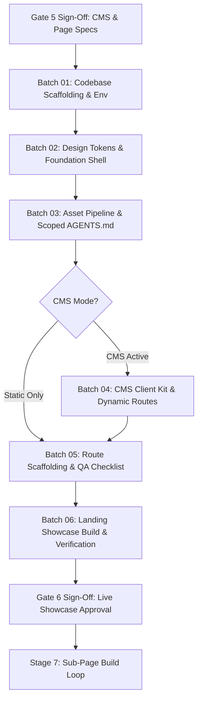

# Codebase Scaffolding, Foundation Build & Landing Page Showcase (Stage 6)

## Table of Contents
- [1. Role & Architecture](#1-role--architecture)
- [2. The 6 Sequential Execution Batches](#2-the-6-sequential-execution-batches)
- [3. Batch Execution Flow & State Machine](#3-batch-execution-flow--state-machine)
- [4. Location & Containment Boundary](#4-location--containment-boundary)
- [5. Master Gate 6 Sign-Off Protocol](#5-master-gate-6-sign-off-protocol)
- [6. Companion Technical References](#6-companion-technical-references)

---

## 1. Role & Architecture

Stage 6 initializes the Next.js App Router application in `site/`, generates the master QA checklist, builds the production foundation shell, scaffolds all application routes from approved Stage 5 specifications, and **fully constructs the Landing Page (`site/app/page.js` + `_components/`) for client showcase**.

> **Homepage-Only Scope Invariant:** In Gate 6, **only the Homepage (Landing Page: `site/app/page.js` + `_components/`) is constructed as a complete, styled page**. Sub-pages (`about`, `services`, `contact`, etc.) are strictly prohibited from being built or styled in Gate 6 (all sub-pages are built incrementally one-by-one in Stage 7). However, the foundation shell constructed alongside the Homepage (root layout, navigation, footer, theme tokens, motion tokens, responsive image component, scoped AGENTS.md rules, and master QA checklist) is engineered with **global scope to all pages**.

To ensure context efficiency, reliability, and deterministic checkpoints, Stage 6 is executed in **6 sequential batches**:

---

## 2. The 6 Sequential Execution Batches

| Batch | Title | Key Deliverables | Reference Guide |
| :---: | :--- | :--- | :--- |
| **01** | **Codebase Scaffolding & Env** | Next.js App Router initialized in `site/` (no nested git), project slug sync, `.gitignore`, `.env.example`, Pre-Launch Guard enabled | [batch-01-codebase-scaffolding/rulebook.md](batch-01-codebase-scaffolding/rulebook.md) |
| **02** | **Foundation Shell & Tokens** | Theme tokens in `globals.css`, motion tier in `motion.js`, `Nav.js`, `Footer.js`, `ResponsiveImage.js`, `Schema.js`, root `layout.js` | [batch-02-foundation-shell/rulebook.md](batch-02-foundation-shell/rulebook.md) |
| **03** | **Asset Pipeline & Agents** | `assets-optimizer` run (<60KB/100KB), `manifest.json`, favicons in `app/`, `site/AGENTS.md` + 4 scoped rule files, `check:all` scripts | [batch-03-asset-pipeline-agents/rulebook.md](batch-03-asset-pipeline-agents/rulebook.md) |
| **04** | **CMS Kit & Dynamic Routes** | Class-based `site/lib/cms/` kit, ISR revalidation route, dynamic blog routes, `/credits` page (conditional on CMS/stock) | [batch-04-cms-kit-integration/rulebook.md](batch-04-cms-kit-integration/rulebook.md) |
| **05** | **Route Scaffolding & QA** | Master QA checklist (`page-checklist.md`), route stubs from `page-list.md`, thin pages (<=80 lines), section components, `site.manifest.json` | [batch-05-route-scaffolding/rulebook.md](batch-05-route-scaffolding/rulebook.md) |
| **06** | **Landing Showcase & Sign-Off** | Full Landing Page built (`site/app/page.js` + `_components/`), `verify-nextjs.mjs` pass, `pnpm build` clean, Gate 6 human sign-off | [batch-06-landing-showcase-verification/rulebook.md](batch-06-landing-showcase-verification/rulebook.md) |

---

## 3. Batch Execution Flow & State Machine

1. **Sequential Pacing:** The agent must execute the batches strictly in order (Batch 01 through Batch 06).
2. **Context Efficiency Rule:** Load only the active batch's rulebook (`batch-[XX]-*/rulebook.md`) during execution rather than inlining all instructions at once.
3. **Safety Precondition:** If `site/` already exists and is non-empty, halt execution immediately and ask the user how to proceed before altering any code.
4. **Tailwind-Only Invariant:** All styling in `site/` must strictly use pure **Tailwind utility classes directly in JSX**; never generate custom CSS classes or use `@apply` in `globals.css`.
5. **Homepage-Only Scope Invariant:** In Gate 6, **only the Homepage is constructed as a complete, styled page**. Sub-pages must never be built in Gate 6. The foundation shell, tokens, shared components, and scoped rules built in Gate 6 have global scope covering all future pages.
6. **Minimum 5 Substantive Sections Per Page (Excluding Bookends) Invariant:** Every page (including Homepage) must orchestrate a **minimum of 5 distinct, substantive semantic sections OTHER THAN Hero, CTA banner, FAQ, Contact Us form, and Footer**. Standard bookends/boilerplate (Hero, CTA, FAQ, Contact Us form, Footer) do NOT count toward this 5-section minimum. Pages must feature at least 5 rich substantive body sections (e.g. Features/Value Grid, Social Proof/Testimonials, How-It-Works/Process, Capabilities/Bento Grid, Stats/Metrics, Case Studies, Comparison Table) in addition to those bookends. Scaffolding thin pages with fewer than 5 substantive body sections is strictly prohibited.
7. **Zero Repeated Content & Exact Sections Invariant:** Only section types (Hero, Features, Social Proof/Testimonials, FAQ, CTA Banner, Process, Bento Grid, Stats) may be repeated across pages. No exact section, identical card layout, or duplicate content/headings may appear across different pages or within the same page. Every section must have unique copywriting, bespoke cards/items, and page-specific value propositions. Shared components are strictly limited to universal site chrome (`Nav`, `Footer`, `PreviewBanner`, `ResponsiveImage`, `Schema`); body sections must never copy identical text across pages.
8. **High FAQ Density Per Page Invariant:** Any page featuring an FAQ section (or dedicated FAQ route) must provide **High FAQ Density** with a **minimum of 10 to 15 comprehensive, substantive FAQs** answering customer objections, technical specifics, pricing, and onboarding details with rich multi-sentence depth. All FAQs across different pages must be 100% unique to that specific page's topic (zero duplicate FAQs across routes).
9. **CMS Token Confirmation & Image Upload Rule:** When connecting to CMS, the agent must confirm the token details (specifically the **Website Name** inside the CMS) before pushing content. The content pipeline engine automatically detects and uploads local images via multipart/form-data to CMS media storage and substitutes paths with live CDN URLs.

---

## 4. Location & Containment Boundary

- **Target Folder:** `site/` strictly at the project root.
- **Safety Precondition:** If `site/` already exists and is not empty, **HALT EXECUTION IMMEDIATELY** and ask the user how to proceed. Never overwrite or re-initialize an existing codebase.
- **Containment Scope:** All codebase writes are confined exclusively to `site/`. Planning docs update `project-docs/page-checklist.md`, `project-docs/router-state.md`, and `project-docs/launch-checklist.md`.
- **Gate Containment Invariant:** Zero loose markdown files outside gates. All planning deliverables under `project-docs/client-review/` and all skill reference documents must strictly live inside their designated gate folders (`gate-0-intake/` through `gate-9-final-verification/`). Creating loose markdown files directly under `references/` or loose in `project-docs/` is strictly prohibited.

---

## 5. Master Gate 6 Sign-Off Protocol

Before declaring Gate 6 complete:
- [ ] **Batch 01 Check:** Next.js App Router codebase initialized in `site/` with slug sync and `.env.example`.
- [ ] **Batch 02 Check:** Foundation shell operational (Nav, Footer, theme tokens, `ResponsiveImage.js`, motion tier in `motion.js`).
- [ ] **Batch 03 Check:** Asset optimizer executed (`manifest.json` emitted), favicons in `site/app/`, 5 scoped `AGENTS.md` files active, `pnpm check:all` passes.
- [ ] **Batch 04 Check:** CMS client kit wired, ISR revalidation route installed, blog routes ready (if CMS active), `/credits` page generated (if stock used).
- [ ] **Batch 05 Check:** `project-docs/page-checklist.md` generated, all route stubs scaffolded matching `page-list.md`, `site/site.manifest.json` validated.
- [ ] **Batch 06 Check:** Landing Page (`site/app/page.js` + `_components/`) fully constructed, styled, and animated for showcase.
- [ ] **Audits Pass:** `verify-nextjs.mjs` passes and `pnpm build` compiles cleanly with zero errors.
- [ ] **Client Presentation:** Interactive Landing Page showcase presented to the client (via local dev server or review deployment).
- [ ] **Gate 6 Sign-Off:** Recorded in `project-docs/router-state.md` (`Gate 6: Scaffolding, Foundation & Landing Page Approved`).
- [ ] **Gate Transaction Compaction:** Remind the user to run `/compact` on Gate 6 sign-off before entering Stage 7 to compact conversation context.
- [ ] **Handover:** Advance to **Stage 7 (Sub-Page Build Loop)** to construct remaining sub-pages sequentially.

---

## 6. Companion Technical References

The following specialized technical reference guides provide in-depth rules and code recipes used across the batches:
- [Motion & UI Component Stack](batch-02-foundation-shell/motion-component-stack.md) — Unified motion tiers (T0–T3), shadcn/ui Base UI foundation, system layers, capped showpieces, and GSAP/Motion separation (Batch 02, Batch 05).
- [GSAP Animation Tiers](batch-02-foundation-shell/gsap-animation-tiers.md) — 6-tier motion architecture and animation loading protocol (Batch 02, Batch 06).
- [Code Conventions & Agent Rules](batch-01-codebase-scaffolding/code-conventions.md) — Line limits (pages <=80, components <=250), Tailwind JSX rules, and scoped AGENTS.md specs (Batch 01, Batch 03, Batch 05).
- [Asset Optimization & Responsive Media](batch-03-asset-pipeline-agents/asset-optimization.md) — Byte budgets (<60KB/<100KB), Sharp/ffmpeg flags, and `manifest.json` schema (Batch 03).
- [Class-Based CMS Kit Guide](batch-04-cms-kit-integration/cms-kit.md) — Class-based data layer, caching, and ISR revalidation specs (Batch 04).
- [Page QA Acceptance Checklist Guide](batch-05-route-scaffolding/page-checklist.md) — Binary PASS/FAIL QA acceptance rules and structure (Batch 05).
