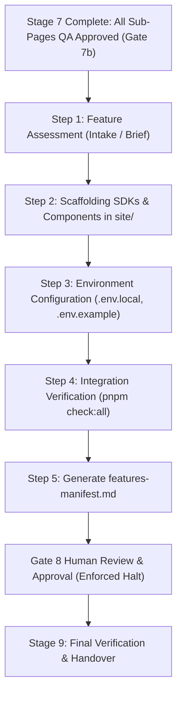

# Stage 8: Additional Features Rulebook

## Table of Contents
- [Overview & Role in Pipeline](#overview--role-in-pipeline)
- [Available Features Catalog](#available-features-catalog)
  - [1. NWW Analytics (`nww-analytics`)](#1-nww-analytics-nww-analytics)
  - [2. Custom & Third-Party Integrations](#2-custom--third-party-integrations)
- [Step-by-Step Implementation Protocol](#step-by-step-implementation-protocol)
  - [Step 1: Feature Assessment & Requirement Ingestion](#step-1-feature-assessment--requirement-ingestion)
  - [Step 2: Component & SDK Scaffolding](#step-2-component--sdk-scaffolding)
  - [Step 3: Environment Variable Configuration](#step-3-environment-variable-configuration)
  - [Step 4: Local Integration Verification & Build Diagnostics](#step-4-local-integration-verification--build-diagnostics)
  - [Step 5: Gate 8 Human Review & Approval](#step-5-gate-8-human-review--approval)
- [Gate 8 Checklist](#gate-8-checklist)

---

## Overview & Role in Pipeline

Stage 8 is the **Additional Features & Modular Integrations** phase of the website creation lifecycle. It bridges **Stage 7 (Sub-Page Build Loop)** and **Stage 9 (Final Verification & Handover)**.

In Stage 7, every sub-page in `project-docs/client-review/gate-3-page-list/page-list.md` was constructed, styled, animated, and verified through Gates 7a and 7b. Before moving to final production audits in Stage 9, Stage 8 incorporates any specialized features, analytics layers, client portals, downloaders, or custom extensions into the Next.js codebase.



---

## Available Features Catalog

Modular feature modules reside in `skills/create-nww-website/references/gate-8-additional-features/site/features/`.

### 1. NWW Analytics (`nww-analytics`)
- **Location**: `skills/create-nww-website/references/gate-8-additional-features/site/features/nww-analytics/`
- **Modules**:
  - `visitor-client-sdk.js`: Standalone, drop-in browser SDK managing anonymous 128-bit device ID persistence, silent session initialization, and proactive token renewal every 14 minutes.
  - `implementation.md`: Authoritative technical specification, REST API contracts, ES256 asymmetric token model, JWKS rotation, and Downloader service contracts.
- **When to Activate**:
  - When the website needs anonymous visitor telemetry or download tracking.
  - When the website interfaces with downstream microservices (such as the YouTube Downloader service) requiring short-lived ES256 Bearer JWTs.
  - When requested in Stage 0 intake brief or open questions.

### 2. Custom & Third-Party Integrations
- Specialized calculators, lead estimators, or conversion widgets.
- Downstream microservice bridges (e.g. YouTube Downloader, file conversion backends).
- External CRM webhooks, calendar booking widgets (Cal.com / Calendly), or chat widgets.

---

## Step-by-Step Implementation Protocol

### Step 1: Feature Assessment & Requirement Ingestion
1. Review `client-context/answers/` and `project-docs/router-state.md` to identify requested additional features.
2. If **no additional features** were requested:
   - Generate `project-docs/client-review/gate-8-additional-features/features-manifest.md` documenting that zero additional features were required.
   - Request Gate 8 confirmation to proceed directly to Stage 9.
3. If **NWW Analytics (`nww-analytics`)** or other features are enabled:
   - Identify the website tenant ID (`NEXT_PUBLIC_NWW_WEBSITE_ID`) and API base URL (`NEXT_PUBLIC_NWW_API_BASE_URL`, default: `https://prod-server.nextwebworks.com`).
   - Consult `skills/create-nww-website/references/gate-8-additional-features/site/features/nww-analytics/implementation.md`.

---

### Step 2: Component & SDK Scaffolding

#### Option A: React Context Provider Pattern (Recommended for Next.js App Router)
1. Scaffold `site/components/VisitorProvider.jsx` (or `.tsx` if TypeScript):
   - Wrap the context around `children`.
   - Maintain `visitorId`, `deviceId`, and `accessToken` state.
   - Proactively renew 15-minute ES256 tokens at 14 minutes (840,000 ms).
   - Expose `useVisitorSession()` hook and `fetchWithToken()` convenience wrapper.
2. In `site/app/layout.js`, wrap the root layout:
   ```jsx
   import { VisitorProvider } from '@/components/VisitorProvider';

   export default function RootLayout({ children }) {
     return (
       <html lang="en">
         <body>
           <VisitorProvider>
             {children}
           </VisitorProvider>
         </body>
       </html>
     );
   }
   ```

#### Option B: Drop-in Browser Script Pattern
1. Copy `visitor-client-sdk.js` to `site/public/scripts/nww-visitor-client-sdk.js`:
   ```bash
   cp skills/create-nww-website/references/gate-8-additional-features/site/features/nww-analytics/visitor-client-sdk.js site/public/scripts/
   ```
2. In `site/app/layout.js`, include Next.js `<Script>` tag with `strategy="afterInteractive"`.

---

### Step 3: Environment Variable Configuration
1. Update `site/.env.local`:
   ```env
   # NWW Analytics / Visitor Identity
   NEXT_PUBLIC_NWW_API_BASE_URL="https://prod-server.nextwebworks.com"
   NEXT_PUBLIC_NWW_WEBSITE_ID="[24-char-mongodb-website-id]"

   # Optional Downloader Microservice
   NEXT_PUBLIC_DOWNLOADER_URL="https://dl.nextwebworks.in"
   ```
2. Update `site/.env.example` and root `.env.example` with credential placeholders (never commit secrets).

---

### Step 4: Local Integration Verification & Build Diagnostics
1. Execute Next.js build check:
   ```bash
   cd site
   pnpm build
   pnpm check:all
   ```
2. Verify:
   - Zero compilation errors, missing modules, or hydration mismatches.
   - Image and bundle budgets remain intact.
   - Zero private secrets (`DOWNLOADER_HMAC_SECRET`, etc.) exposed in client bundles.
   - Anonymous visitor tokens successfully initialize without blocking SSR or page load.

---

### Step 5: Gate 8 Human Review & Approval

1. Generate the Gate 8 deliverable at `project-docs/client-review/gate-8-additional-features/features-manifest.md`:
   ```markdown
   # Gate 8 Deliverable: Additional Features Manifest

   **Website Tenant ID:** [NEXT_PUBLIC_NWW_WEBSITE_ID]
   **Integrated Features:**
   - [x] NWW Visitor Identity & Telemetry (`nww-analytics`)
     - Persistent 128-bit device ID in `localStorage`
     - 15-minute asymmetric ES256 Bearer JWTs
     - Proactive token renewal at 14 minutes
     - Downstream fetch wrapper (`useVisitorSession`)
   - [ ] Additional custom modules: [None / List]

   **Verification Status:**
   - Production build: Passing
   - Secret hygiene: Clean
   ```
2. Update `project-docs/router-state.md`:
   - Set `Current Stage: 8`
   - Set `Current Gate: Gate 8`
   - Set `Status: awaiting_approval`
3. **Enforced Halt:** Present the features manifest to the user. Halt execution until explicit human confirmation ("approved", "proceed") is received.

---

## Gate 8 Checklist

Before advancing to Stage 9 (Final Verification & Handover):
- [ ] Requirements for additional features ingested from intake brief and open questions.
- [ ] Feature modules scaffolded into `site/components/`, `site/lib/`, or `site/public/`.
- [ ] Root layout updated with feature providers without breaking SSR.
- [ ] Environment variables documented in `.env.example` and configured in `.env.local`.
- [ ] `pnpm build` and `pnpm check:all` pass cleanly in `site/`.
- [ ] Gate 8 deliverable written to `project-docs/client-review/gate-8-additional-features/features-manifest.md`.
- [ ] Router state updated in `project-docs/router-state.md`.
- [ ] **Gate 8 Halt:** Human review presented; explicit approval received to advance to Stage 9.

