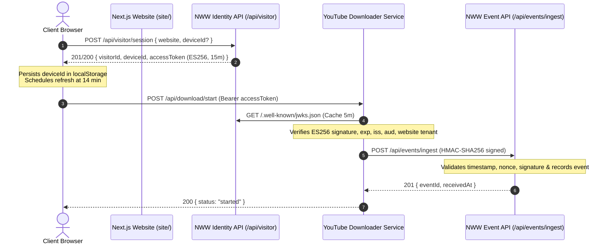

# NextWebWorks (NWW) Visitor Identity & Telemetry (NWW Analytics)

## Overview & Architecture

NWW Analytics provides a privacy-preserving, anonymous visitor identity and telemetry system tailored for Next.js App Router websites and companion microservices (e.g., download engines, media processing services).

It replaces legacy authenticated user tracking with:
1. **Persistent Device Identity**: An anonymous 128-bit hex device ID persisted in `localStorage`.
2. **Short-Lived Asymmetric Access Tokens**: 15-minute ES256 (ECDSA NIST P-256) signed JSON Web Tokens (JWTs).
3. **Public JWKS Key Distribution**: An RFC 7517 compliant JSON Web Key Set (`/.well-known/jwks.json`) with automated key rotation tracking up to 3 historical keys.
4. **Zero-Raw-IP Privacy**: IPv4 subnet masking to `/24`, IPv6 truncation to `/48`, salted HMAC hashing for abuse prevention, and geolocation extraction via CDN edge headers.
5. **Server-to-Server Telemetry Ingestion**: Secure HMAC-SHA256 event reporting with replay nonce protection, clock drift bounds, and browser origin rejection.
6. **Multi-Tenant Website Scope**: Strict tenant isolation binding all sessions, tokens, and events to the website's MongoDB identifier.



---

## 1. Status Summary

| Capability | Status | Evidence |
|---|---|---|
| **Visitor Device ID Generation & Permanent Storage** | **Implemented** | 128-bit random hex string generated via `crypto.randomBytes(16)`; SHA-256 hashed in database (`deviceIdHash`); persistent browser storage via `localStorage` (`nww_device_<websiteId>`). |
| **Silent Device ID Re-issuance on Loss** | **Implemented** | Fallback generation when presenting unknown or corrupted device IDs silently issues a fresh device ID without disrupting the user experience. |
| **Short-Lived (15-min) ES256 Access Token Issuance** | **Implemented** | NIST P-256 (`prime256v1`) elliptic curve asymmetric JWT with 900-second expiration issued via `POST /api/visitor/session` and `POST /api/visitor/token`. |
| **Public RFC 7517 JWKS Key Publication & Rotation** | **Implemented** | JWKS served at `/api/visitor/.well-known/jwks.json` and root `/.well-known/jwks.json`; rotation retains active key and last 3 historical keys. |
| **Privacy-Preserving Visitor Metadata Extraction** | **Implemented** | IPv4 truncated to `/24`, IPv6 truncated to `/48`, raw IP never stored; salted HMAC IP hash for abuse rate limiting; CDN headers (`cf-ipcountry`, `cloudfront-viewer-country`, `cf-region-code`) parsed. |
| **Append-Only Download / User Event Telemetry Model** | **Implemented** | Schema supporting YouTube and playlist types (`video`, `thumbnail`, `audio`, `playlist-*`, `page_view`, `custom`). |
| **Server-to-Server HMAC Ingestion Endpoint** | **Implemented** | HMAC-SHA256 signature validation with `X-NWW-Timestamp`, `X-NWW-Nonce`, `X-NWW-Signature`, 5-minute clock drift limit, in-memory replay prevention, and browser `Origin` rejection. |
| **Tenant Isolation & Website Scope Enforcement** | **Implemented** | Token and event ingestion enforce website ownership and active status; unique compound index `{ website: 1, deviceIdHash: 1 }`. |
| **Admin Read Queries & Privacy Removal (Delete-by-VisitorId)** | **Implemented** | Admin endpoints for paginated visitors, individual timeline inspection, and cascading GDPR deletion wiping the visitor and all associated events. |
| **12-Month Inactivity Retention Job** | **Implemented (Audit-Only)** | Daily scheduler job checks inactive records older than 365 days; operates in audit-only mode per current operational directive (`"DO NOT DELETE ANYTHING FOR NOW"`). |
| **Isolation of Sign-in & Authentication on Websites** | **Implemented** | Public `/auth` routes unmounted from public API registry; consumer websites interact strictly through visitor session identity. |
| **Rate Limiting at Identity Layer** | **Implemented** | Ingestion limits: 10 requests/min per IP for `/api/visitor/session`, 30 requests/min per IP for `/api/visitor/token`. |

---

## 2. API Reference

### 2.1 Public Identity Endpoints

#### 1. POST `/api/visitor/session`
Initializes a visitor session or validates an existing device ID. If the device ID is recognized, it updates `lastSeenAt` and increments `visitCount`. If omitted or unrecognized, it silently issues a new 128-bit opaque device ID.

- **Auth**: None (Public)
- **Rate Limit**: 10 requests per minute per IP
- **Request Headers**: `Content-Type: application/json`
- **Request Body JSON**:
```json
{
  "website": "671234567890abcdef123456",
  "deviceId": "b478d46fb05c4856a9dc1977b5d15c7e"
}
```
*(Note: `siteId` is accepted as an alias for `website`).*

- **Response JSON (201 Created - New Visitor)**:
```json
{
  "success": true,
  "code": 201,
  "message": "Visitor session created",
  "body": {
    "visitorId": "672345678901abcdef234567",
    "website": "671234567890abcdef123456",
    "siteId": "671234567890abcdef123456",
    "deviceId": "b478d46fb05c4856a9dc1977b5d15c7e",
    "accessToken": "eyJhbGciOiJFUzI1NiIsImtpZCI6Im53dy12aXNpdG9yLTIwMjYtdjEiLCJ0eXAiOiJKV1QifQ...",
    "tokenType": "Bearer",
    "expiresIn": 900,
    "isNew": true
  }
}
```
- **Response JSON (200 OK - Recognized Device)**: Same payload structure, with `isNew: false`, preserving the caller's existing `deviceId`.
- **Status Codes**:
  - `200 OK`: Existing session refreshed.
  - `201 Created`: New session and device ID issued.
  - `400 Bad Request`: `WEBSITE_REQUIRED`.
  - `403 Forbidden`: `SITE_INACTIVE_OR_NOT_FOUND` or `DEVICE_REVOKED`.
  - `429 Too Many Requests`: `RATE_LIMIT_EXCEEDED`.

---

#### 2. POST `/api/visitor/token`
Exchanges an existing device ID for a fresh 15-minute access token without re-initializing full session state.

- **Auth**: None (Public)
- **Rate Limit**: 30 requests per minute per IP
- **Request Body JSON**:
```json
{
  "website": "671234567890abcdef123456",
  "deviceId": "b478d46fb05c4856a9dc1977b5d15c7e"
}
```
- **Response JSON (200 OK)**:
```json
{
  "success": true,
  "code": 200,
  "message": "Access token issued",
  "body": {
    "visitorId": "672345678901abcdef234567",
    "website": "671234567890abcdef123456",
    "siteId": "671234567890abcdef123456",
    "accessToken": "eyJhbGciOiJFUzI1NiIsImtpZCI6Im53dy12aXNpdG9yLTIwMjYtdjEiLCJ0eXAiOiJKV1QifQ...",
    "tokenType": "Bearer",
    "expiresIn": 900
  }
}
```
- **Status Codes**:
  - `200 OK`: Fresh token issued.
  - `400 Bad Request`: `DEVICE_ID_REQUIRED` or `WEBSITE_REQUIRED`.
  - `401 Unauthorized`: `DEVICE_NOT_FOUND` (Client should fall back to `/api/visitor/session`).
  - `403 Forbidden`: `DEVICE_REVOKED` or `SITE_INACTIVE_OR_NOT_FOUND`.
  - `429 Too Many Requests`: `RATE_LIMIT_EXCEEDED`.

---

#### 3. GET `/api/visitor/.well-known/jwks.json` & GET `/.well-known/jwks.json`
Exposes the RFC 7517 compliant JSON Web Key Set containing active and rotated public keys.

- **Auth**: None (Public)
- **Response Headers**: `Content-Type: application/json`, `Cache-Control: public, max-age=3600`
- **Response JSON (200 OK)**:
```json
{
  "keys": [
    {
      "kty": "EC",
      "crv": "P-256",
      "x": "W8vN2N...",
      "y": "gK892b...",
      "use": "sig",
      "alg": "ES256",
      "kid": "nww-visitor-2026-v1"
    }
  ]
}
```

---

### 2.2 Telemetry Ingestion Endpoint

#### 4. POST `/api/events/ingest`
Server-to-server endpoint for receiving download and telemetry events from the YouTube Downloader service or authorized backends.

- **Auth**: HMAC-SHA256 signature verification.
- **Browser Protection**: Direct browser submissions containing `Origin` or `Sec-Fetch-Mode: cors` headers are rejected with `403 BROWSER_CALLS_DISALLOWED`.
- **Required Headers**:
  - `X-NWW-Timestamp`: Milliseconds epoch string (must be within $\pm$300,000 ms of NWW server clock).
  - `X-NWW-Nonce`: Unique UUIDv4 or 16-byte random string (cached for 5 minutes).
  - `X-NWW-Signature`: Format `sha256=<hex>` computed as $\text{HMAC-SHA256}(\text{DOWNLOADER\_HMAC\_SECRET}, `${timestamp}.${nonce}.${rawBody}`)$.
- **Request Body JSON**:
```json
{
  "visitorId": "672345678901abcdef234567",
  "website": "671234567890abcdef123456",
  "eventType": "video",
  "youtubeId": "dQw4w9WgXcQ",
  "playlistId": null,
  "format": "mp4-1080p",
  "status": "completed",
  "errorMessage": null,
  "timestamp": 1729000000000,
  "metadata": {
    "fileSize": 104857600,
    "duration": 212
  }
}
```
*(Accepted `eventType` values: `"video"`, `"thumbnail"`, `"audio"`, `"playlist-video"`, `"playlist-audio"`, `"playlist-thumbnail"`, `"playlist-complete"`, `"page_view"`, `"custom"`).*  
*(Accepted `status` values: `"started"`, `"completed"`, `"failed"`).*

- **Response JSON (201 Created)**:
```json
{
  "success": true,
  "code": 201,
  "message": "Website user event recorded successfully",
  "body": {
    "eventId": "672345678901abcdef999999",
    "receivedAt": "2026-11-02T19:40:00.000Z"
  }
}
```
- **Status Codes**:
  - `201 Created`: Event saved.
  - `400 Bad Request`: `MISSING_REQUIRED_FIELDS` or `INVALID_IDENTIFIER_FORMAT`.
  - `401 Unauthorized`: `SIGNATURE_MISSING`, `SIGNATURE_INVALID`, or `REQUEST_EXPIRED`.
  - `403 Forbidden`: `BROWSER_CALLS_DISALLOWED` or `SITE_INACTIVE_OR_NOT_FOUND`.
  - `404 Not Found`: `VISITOR_NOT_FOUND` (visitor does not exist or does not belong to the target website tenant).
  - `409 Conflict`: `REPLAYED_REQUEST` (nonce already received within active 5-minute replay window).

---

### 2.3 Authenticated Admin Endpoints

Guarded by administrative session authentication. Query filters automatically restrict results to `req.user.website` for non-SuperAdmin users.

- `GET /api/visitor/admin/paginate` — Paginated visitor documents (`page`, `limit`, `country`, `status`, `from`, `to`, `search`).
- `GET /api/visitor/admin/read-one/:id` — Single visitor object scoped to tenant.
- `GET /api/visitor/admin/:id/events` — Visitor document and up to 100 recent `WebsiteUserEvent` records.
- `DELETE /api/visitor/admin/:id` — Permanently deletes visitor and executes a cascading `deleteMany` on all associated `WebsiteUserEvent` records.
- `GET /api/website-user-event/admin/paginate` — Paginated telemetry events.
- `GET /api/website-user-event/admin/stats` — Aggregated tenant metrics (`totalEvents`, `completedEvents`, `failedEvents`, `eventTypeCounts`).

---

## 3. Token and Identity Model

```
                    ┌─────────────────────────────────────────────────────────────┐
                    │               128-bit Opaque Device ID                      │
                    │               (e.g. b478d46fb05c4856a9dc1977b5d15c7e)       │
                    └─────────────────────────────┬───────────────────────────────┘
                                                  │
                 ┌────────────────────────────────┴────────────────────────────────┐
                 ▼                                                                 ▼
      Stored on Client Device                                           Stored in MongoDB
      (localStorage: nww_device_<websiteId>)                            (SHA-256 Hashed: deviceIdHash)
                 │                                                                 │
                 └────────────────────────┬────────────────────────────────────────┘
                                          │ POST /api/visitor/token
                                          ▼
                    ┌─────────────────────────────────────────────────────────────┐
                    │               Short-Lived Signed JWT Access Token           │
                    │               (Asymmetric ES256, 15-Minute Lifespan)        │
                    └─────────────────────────────────────────────────────────────┘
```

### 3.1 Device ID Format & Storage
- **Format**: Random 128-bit opaque value formatted as a 32-character hexadecimal string, generated using `crypto.randomBytes(16).toString("hex")`.
- **Client Storage**: Persisted in `localStorage` under key `nww_device_<websiteId>`.
- **Database Storage**: Raw device IDs are **never** stored in the database. The database stores `deviceIdHash = crypto.createHash("sha256").update(deviceId).digest("hex")`.
- **Silent Recovery**: If a device presents an invalid or unrecognized device ID, NWW generates a brand new device ID silently and returns it in the session response.

### 3.2 Access Token Specifications
- **Signing Algorithm**: **ES256** (ECDSA using the NIST P-256 curve `prime256v1` and SHA-256).
- **Token Lifetime**: Exactly 15 minutes (`expiresIn: 900` seconds).
- **JOSE Header**:
```json
{
  "alg": "ES256",
  "typ": "JWT",
  "kid": "nww-visitor-2026-v1"
}
```
- **JWT Claims Payload**:
```json
{
  "sub": "672345678901abcdef234567",          // MongoDB ObjectId of Visitor
  "website": "671234567890abcdef123456",      // MongoDB ObjectId of Website
  "iss": "https://auth.nextwebworks.in",       // VISITOR_JWT_ISSUER
  "aud": "nww-youtube-downloader",             // VISITOR_JWT_AUDIENCE
  "iat": 1729000000,
  "exp": 1729000900
}
```

### 3.3 Key Rotation & JWKS URL
- **JWKS Endpoint**: `GET https://<nww-domain>/api/visitor/.well-known/jwks.json` and `GET https://<nww-domain>/.well-known/jwks.json`.
- **Rotation Mechanism**: The key manager maintains an active key and up to 3 historical public keys in the `historicalKeys` array. Both active and historical keys are serialized into the JWKS response so unexpired tokens issued before rotation verify without interruption.

---

## 4. Next.js Integration Guide

NWW integrates with consumer websites built using the **Next.js App Router** (`app/layout.js`, React Server Components, Client Components, and Route Handlers).

### 4.1 Environment Variables
Configure in `site/.env.local` and `site/.env.example`:

| Variable Name | Exposure | Purpose |
|---|---|---|
| `NEXT_PUBLIC_NWW_API_BASE_URL` | Browser & Server | Base URL of the NWW API (default: `https://prod-server.nextwebworks.com`). |
| `NEXT_PUBLIC_NWW_WEBSITE_ID` | Browser & Server | 24-character hexadecimal `Website` tenant ID assigned in NWW. |
| `NEXT_PUBLIC_DOWNLOADER_URL` | Browser & Server | URL of the YouTube Downloader service (e.g. `https://dl.nextwebworks.in`). |
| `DOWNLOADER_HMAC_SECRET` | **Server-Only (Private)** | Shared HMAC secret for server-to-server operations. Never expose to client. |

---

### 4.2 Browser Storage & Token Lifecycle
1. On initial mount, the browser checks `localStorage.getItem("nww_device_" + websiteId)`.
2. The client calls `POST /api/visitor/session` sending `{ website, deviceId }`.
3. NWW responds with `visitorId`, `deviceId`, and `accessToken` (valid for 15 minutes). The client saves `deviceId` back into `localStorage`.
4. A timer proactively refreshes the access token at **14 minutes** (840,000 ms) via `POST /api/visitor/token`.

---

### 4.3 Client Helper / React Context

Create `site/components/VisitorProvider.jsx` (or `.tsx`):

```tsx
"use client";

import React, { createContext, useContext, useEffect, useState } from "react";

const VisitorContext = createContext({
  visitorId: null,
  websiteId: "",
  accessToken: null,
  fetchWithToken: fetch,
});

export function VisitorProvider({
  children,
  websiteId = process.env.NEXT_PUBLIC_NWW_WEBSITE_ID,
  apiBaseUrl = process.env.NEXT_PUBLIC_NWW_API_BASE_URL || "https://prod-server.nextwebworks.com",
}) {
  const [visitorId, setVisitorId] = useState(null);
  const [accessToken, setAccessToken] = useState(null);

  useEffect(() => {
    if (!websiteId || !apiBaseUrl) return;

    const storageKey = `nww_device_${websiteId}`;
    let refreshTimer;

    async function initSession() {
      try {
        let storedDeviceId = null;
        try {
          storedDeviceId = localStorage.getItem(storageKey);
        } catch (e) {}

        const res = await fetch(`${apiBaseUrl.replace(/\/$/, "")}/api/visitor/session`, {
          method: "POST",
          headers: { "Content-Type": "application/json" },
          body: JSON.stringify({ website: websiteId, deviceId: storedDeviceId || undefined }),
        });

        if (!res.ok) return;
        const data = await res.json();
        const body = data.body || {};

        setVisitorId(body.visitorId);
        setAccessToken(body.accessToken);

        if (body.deviceId) {
          try {
            localStorage.setItem(storageKey, body.deviceId);
          } catch (e) {}
        }

        // Proactive token refresh at 14 minutes (840 seconds)
        const refreshMs = Math.max(((body.expiresIn || 900) - 60) * 1000, 60000);
        refreshTimer = setTimeout(() => refreshToken(body.deviceId), refreshMs);
      } catch (err) {
        console.error("[NWW Visitor] Failed to initialize visitor session:", err);
      }
    }

    async function refreshToken(deviceId) {
      try {
        const res = await fetch(`${apiBaseUrl.replace(/\/$/, "")}/api/visitor/token`, {
          method: "POST",
          headers: { "Content-Type": "application/json" },
          body: JSON.stringify({ website: websiteId, deviceId }),
        });

        if (!res.ok) {
          return initSession(); // Re-initialize if token refresh fails
        }

        const data = await res.json();
        const body = data.body || {};
        setAccessToken(body.accessToken);

        const refreshMs = Math.max(((body.expiresIn || 900) - 60) * 1000, 60000);
        refreshTimer = setTimeout(() => refreshToken(deviceId), refreshMs);
      } catch (err) {
        console.warn("[NWW Visitor] Refresh failed, retrying in 1 minute:", err);
        refreshTimer = setTimeout(() => refreshToken(deviceId), 60000);
      }
    }

    initSession();

    return () => {
      if (refreshTimer) clearTimeout(refreshTimer);
    };
  }, [websiteId, apiBaseUrl]);

  const fetchWithToken = async (url, init = {}) => {
    const headers = new Headers(init.headers || {});
    if (accessToken) {
      headers.set("Authorization", `Bearer ${accessToken}`);
    }
    return fetch(url, { ...init, headers });
  };

  return (
    <VisitorContext.Provider value={{ visitorId, websiteId, accessToken, fetchWithToken }}>
      {children}
    </VisitorContext.Provider>
  );
}

export const useVisitorSession = () => useContext(VisitorContext);
```

Wrap the root layout (`site/app/layout.js`):
```jsx
import { VisitorProvider } from "@/components/VisitorProvider";

export default function RootLayout({ children }) {
  return (
    <html lang="en">
      <body>
        <VisitorProvider>
          {children}
        </VisitorProvider>
      </body>
    </html>
  );
}
```

Triggering downstream services from client components (`site/components/DownloadAction.jsx`):
```jsx
"use client";

import { useVisitorSession } from "@/components/VisitorProvider";

export function DownloadAction({ youtubeId }) {
  const { fetchWithToken } = useVisitorSession();

  const handleDownload = async () => {
    const downloaderUrl = process.env.NEXT_PUBLIC_DOWNLOADER_URL;
    const res = await fetchWithToken(`${downloaderUrl}/api/download/start`, {
      method: "POST",
      headers: { "Content-Type": "application/json" },
      body: JSON.stringify({
        youtubeId,
        format: "mp4-1080p",
      }),
    });
    const result = await res.json();
    console.log("Download task started:", result);
  };

  return (
    <button onClick={handleDownload} className="px-4 py-2 bg-blue-600 text-white rounded font-medium">
      Download Video
    </button>
  );
}
```

---

## 5. Contract for the Downloader Service

The YouTube Downloader service is an independent microservice communicating with NWW via two contracts:

### 5.1 Touchpoint 1: Ingress Visitor Token Verification
When a visitor triggers a download, the Downloader verifies the Bearer token against NWW's JWKS:

```
[ Visitor Browser ] ──────── (Bearer JWT) ───────► [ YouTube Downloader ]
                                                            │
                                                     (Fetches JWKS)
                                                            ▼
                                                   [ NWW JWKS Endpoint ]
                                           /api/visitor/.well-known/jwks.json
```

#### Mandatory Verification Rules:
1. **Algorithm Pinning**: The Downloader **must pin algorithm validation strictly to `ES256`**. Tokens with `alg: "HS256"`, `alg: "RS256"`, or `alg: "none"` must be rejected immediately.
2. **Key ID (`kid`) Lookup**: Verify against the matching key in the JWKS `keys` array.
3. **Issuer**: Must strictly equal `https://auth.nextwebworks.in` (or configured `VISITOR_JWT_ISSUER`).
4. **Audience**: Must strictly equal `nww-youtube-downloader`.
5. **Expiration**: `exp` must be in the future (lifespan is 15 minutes).
6. **Tenant Boundary Match**: The `website` claim extracted from the token **must match** the specific website tenant where the download originated.

---

### 5.2 Touchpoint 2: HMAC Telemetry Event Ingestion
When a download starts, completes, or fails, the Downloader dispatches telemetry metadata to `POST /api/events/ingest`.

#### Header & Signature Specification:
- `X-NWW-Timestamp`: Unix millisecond timestamp string (`Date.now().toString()`).
- `X-NWW-Nonce`: Random UUID or hex nonce.
- `X-NWW-Signature`: `sha256=<hex_digest>` where digest is computed as:
  $$\text{HMAC-SHA256}(\text{DOWNLOADER\_HMAC\_SECRET}, \ `${timestamp}.${nonce}.${rawJsonBodyString}`\ )$$

#### Verified Node.js Downloader Implementation:
```javascript
const crypto = require("crypto");
const { createRemoteJWKSet, jwtVerify } = require("jose");

const NWW_JWKS_URL = new URL("https://auth.nextwebworks.in/api/visitor/.well-known/jwks.json");
const jwks = createRemoteJWKSet(NWW_JWKS_URL, { cooldownDuration: 300000 });

/**
 * 1. Verify Visitor Token (Ingress)
 */
async function verifyVisitorToken(bearerToken, expectedWebsiteId) {
    const { payload } = await jwtVerify(bearerToken, jwks, {
        algorithms: ["ES256"], // Pin to ES256
        issuer: "https://auth.nextwebworks.in",
        audience: "nww-youtube-downloader",
    });

    if (payload.website !== expectedWebsiteId) {
        throw new Error(`Tenant mismatch: token website ${payload.website} !== ${expectedWebsiteId}`);
    }

    return {
        visitorId: payload.sub,
        website: payload.website,
    };
}

/**
 * 2. Report Download Event (Egress)
 */
async function reportDownloadEvent(eventData, hmacSecret, nwwBaseUrl) {
    const bodyString = JSON.stringify(eventData);
    const timestamp = Date.now().toString();
    const nonce = crypto.randomUUID();

    const signaturePayload = `${timestamp}.${nonce}.${bodyString}`;
    const hmacHex = crypto
        .createHmac("sha256", hmacSecret)
        .update(signaturePayload)
        .digest("hex");

    const response = await fetch(`${nwwBaseUrl.replace(/\/$/, "")}/api/events/ingest`, {
        method: "POST",
        headers: {
            "Content-Type": "application/json",
            "User-Agent": "NWW-YouTube-Downloader/1.0",
            "X-NWW-Timestamp": timestamp,
            "X-NWW-Nonce": nonce,
            "X-NWW-Signature": `sha256=${hmacHex}`,
        },
        body: bodyString,
    });

    if (!response.ok) {
        const errorData = await response.json().catch(() => ({}));
        throw new Error(`Event ingestion failed [${response.status}]: ${errorData.message || response.statusText}`);
    }

    return await response.json();
}

module.exports = { verifyVisitorToken, reportDownloadEvent };
```

---

## 6. Data Stored

### 6.1 `Visitor` Collection Schema

| Field Name | Type | Constraints / Storage Behavior | Purpose |
|---|---|---|---|
| `_id` | `ObjectId` | Auto-generated MongoDB primary key | Unique visitor identifier (`visitorId`). |
| `website` | `ObjectId` | `required: true, ref: "Website", index: true` | Tenant website reference. |
| `user` | `ObjectId` | `ref: "User", default: null` | Website owner account reference. |
| `deviceIdHash` | `String` | `required: true, index: true` | SHA-256 hash of raw device ID (`crypto.createHash('sha256')`). |
| `firstSeenAt` | `Date` | `default: Date.now` | Timestamp of visitor creation. |
| `lastSeenAt` | `Date` | `default: Date.now, index: true` | Timestamp of most recent activity. |
| `visitCount` | `Number` | `default: 1, min: 1` | Cumulative visit count. |
| `country` | `String` | `maxLength: 10, index: true, default: null` | Uppercase 2-letter ISO code from CDN headers (`cf-ipcountry`, etc.). |
| `region` | `String` | `maxLength: 50, default: null` | Region code from CDN headers (`cf-region-code`, etc.). |
| `ip` | `String` | `required: true, trim: true` | **Subnet-truncated IP only** (`/24` for IPv4, `/48` for IPv6). |
| `ipHash` | `String` | `required: true, index: true` | Salted HMAC-SHA256 hash of IP for abuse rate-limiting. |
| `userAgent` | `String` | `maxLength: 500, default: null` | Truncated User-Agent header string. |
| `referrer` | `String` | `maxLength: 500, default: null` | Truncated HTTP Referer header string. |
| `language` | `String` | `maxLength: 50, default: null` | Primary language tag from `Accept-Language`. |
| `status` | `String` | `enum: ["active", "revoked"], default: "active"` | Administrative access status. |
| `isDeleted` | `Boolean` | `default: false, index: true` | Soft deletion flag. |

- **Compound Indexes**:
  - `{ website: 1, deviceIdHash: 1 }` (unique constraint)
  - `{ website: 1, isDeleted: 1, lastSeenAt: -1 }`

---

### 6.2 `WebsiteUserEvent` Collection Schema

| Field Name | Type | Constraints / Storage Behavior | Purpose |
|---|---|---|---|
| `_id` | `ObjectId` | Auto-generated MongoDB primary key | Unique telemetry event ID. |
| `visitor` | `ObjectId` | `required: true, ref: "Visitor", index: true` | Linked visitor document. |
| `website` | `ObjectId` | `required: true, ref: "Website", index: true` | Tenant website document. |
| `eventType` | `String` | `required: true, index: true` | `"video"`, `"thumbnail"`, `"audio"`, `"playlist-*"`, etc. |
| `youtubeId` | `String` | `maxLength: 100, default: null` | YouTube video ID. |
| `playlistId` | `String` | `maxLength: 100, default: null` | Parent YouTube playlist ID. |
| `format` | `String` | `maxLength: 50, default: null` | Format tag (e.g. `"mp4-1080p"`). |
| `status` | `String` | `required: true, enum: ["started", "completed", "failed"]` | Execution status. |
| `metadata` | `Mixed` | `default: {}` | Arbitrary JSON metadata (file size, duration, etc.). |
| `errorMessage` | `String` | `maxLength: 500, default: null` | Diagnostic error message on failure. |
| `timestamp` | `Date` | `required: true, index: true` | Client-provided event timestamp. |
| `receivedAt` | `Date` | `default: Date.now` | Server receipt timestamp. |
| `isDeleted` | `Boolean` | `default: false, index: true` | Soft deletion flag. |

- **Compound Indexes**:
  - `{ website: 1, visitor: 1, timestamp: -1 }`
  - `{ website: 1, eventType: 1, timestamp: -1 }`
  - `{ visitor: 1, timestamp: -1 }`

---

### 6.3 IP Address Handling & Privacy Guarantee
Raw IP addresses are **never written to disk or database**:
1. **Truncation**: IPv4 addresses have their host octet masked to `0/24` (e.g. `203.0.113.195` $\rightarrow$ `203.0.113.0/24`). IPv6 addresses are truncated to `/48` (e.g. `2001:db8:85a3::/48`).
2. **Salted Hash**: A salted HMAC-SHA256 (`ipHash`) using `IP_HASH_SALT` allows abuse rate limiting without preserving identifiable network addresses.

---

### 6.4 Retention Policy
1. **Automated Scheduled Audit**:
   - `VisitorRetentionJob` runs daily on the background scheduler.
   - Operates in **audit-only** mode: queries visitors where `lastSeenAt < cutoff (365 days)` and logs the count without deleting documents.
2. **Privacy Removal (Delete-by-VisitorId)**:
   - Calling `DELETE /api/visitor/admin/:id` permanently deletes the target visitor record and executes a cascading `deleteMany` across all linked `WebsiteUserEvent` records.

