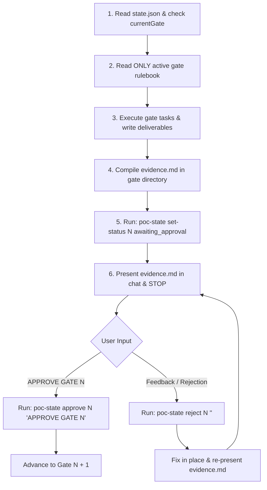

# PoC to Proposal (`poc-to-proposal`)

> [!IMPORTANT]
> **Production Freeze Override:**
> Nothing goes to production, and nothing merges to `main` in `nextwebworks-website` or any live repository, without the relevant gate's explicit human approval.
>
> **Human Approval Barrier:**
> An approval requires the exact verbatim phrase `APPROVE GATE N` typed by the human in chat. Colloquial phrases (such as "looks good", "go ahead", "approved", "proceed") are strictly rejected. Gates cannot be skipped, bypassed, or reordered.
>
> **Progressive Disclosure Invariant:**
> The agent MUST read ONLY the active gate's rulebook. Reading future gate rulebooks eagerly is strictly forbidden to preserve context tokens and enforce gate containment.
>
> **Single Task Scope:**
> This skill governs only the transition of an existing PoC into an executive proposal package. Do not modify unrelated workspace features during this workflow.

---

## Overview

This skill guides a finished Proof-of-Concept (PoC) through an eight-stage human-gated checklist. Every gate writes its deliverables into `poc/<project>/gate-N-<gate-name>/` inside the target PoC repository and concludes with an `evidence.md` file and state verification before pausing for explicit human sign-off.

---

## State Machine Helper (`poc-state.mjs`)

Progress is tracked deterministically in `poc/<project>/state.json` using the companion CLI helper.

> [!TIP]
> **Scripts Over Prompts:** Always run `node <path>/poc-state.mjs --help` to inspect CLI commands rather than reading script source files.

### Common Helper Commands

```bash
# Display CLI help and flag usage
node <path-to-skill>/scripts/poc-state.mjs --help

# Initialize state.json for a new PoC project
node <path-to-skill>/scripts/poc-state.mjs init <project>

# Inspect current gate and status summary
node <path-to-skill>/scripts/poc-state.mjs status

# Set gate status (pending | in_progress | awaiting_approval | approved | rejected)
node <path-to-skill>/scripts/poc-state.mjs set-status <N> awaiting_approval

# Approve gate N with exact verbatim phrase (advances currentGate)
node <path-to-skill>/scripts/poc-state.mjs approve <N> "APPROVE GATE N"

# Record rejection feedback from the user
node <path-to-skill>/scripts/poc-state.mjs reject <N> "<feedback reason>"

# Update metadata or URL fields (secrets are blocked)
node <path-to-skill>/scripts/poc-state.mjs set-field nwwWebsiteRepo "/path/to/nextwebworks-website"
node <path-to-skill>/scripts/poc-state.mjs set-field urls.prod "https://my-poc.vercel.app"
```

---

## The Gate Execution Loop

For each gate $N \in [1, 8]$, the agent strictly executes the following cycle:



1. **Read State:** Verify `currentGate` in `poc/<project>/state.json`.
2. **Read Active Rulebook Only:** Open strictly `references/gate-N-<gate-name>/rulebook.md`. Do not open future gates.
3. **Execute Gate Work:** Produce all required deliverables directly inside `poc/<project>/gate-N-<gate-name>/`.
4. **Compile Evidence:** Write `poc/<project>/gate-N-<gate-name>/evidence.md` summarizing verified items.
5. **Set Status:** Execute `node <path>/poc-state.mjs set-status <N> awaiting_approval`.
6. **Stop & Present:** Present the evidence summary and manual checklist in chat, then **STOP CALLING TOOLS**.
7. **Handle Human Response:**
   - If the user types **`APPROVE GATE N`**: Run `node <path>/poc-state.mjs approve <N> "APPROVE GATE N"` and proceed to Gate $N+1$.
   - If the user provides feedback or rejection: Run `node <path>/poc-state.mjs reject <N> "<reason>"`, update the gate's files in place, update `evidence.md`, reset status to `awaiting_approval`, and re-present. Never create duplicate deliverable files.

---

## Gate Directory & Rulebook Pointers

| Gate | Name | Deliverable Directory | Rulebook |
| :---: | :--- | :--- | :--- |
| **1** | **Freeze Scope** | `poc/<project>/gate-1-freeze-scope/` | [Gate 1 Rulebook](references/gate-1-freeze-scope/rulebook.md) |
| **2** | **Manual Test** | `poc/<project>/gate-2-manual-test/` | [Gate 2 Rulebook](references/gate-2-manual-test/rulebook.md) |
| **3** | **Complete & Hosted** | `poc/<project>/gate-3-complete-and-hosted/` | [Gate 3 Rulebook](references/gate-3-complete-and-hosted/rulebook.md) |
| **4** | **Landing Page & Leads** | `poc/<project>/gate-4-landing-page-leads/` | [Gate 4 Rulebook](references/gate-4-landing-page-leads/rulebook.md) |
| **5** | **Demo Subdomain** | `poc/<project>/gate-5-demo-subdomain/` | [Gate 5 Rulebook](references/gate-5-demo-subdomain/rulebook.md) |
| **6** | **Walkthrough Video** | `poc/<project>/gate-6-walkthrough/` | [Gate 6 Rulebook](references/gate-6-walkthrough/rulebook.md) |
| **7** | **Case Study** | `poc/<project>/gate-7-case-study/` | [Gate 7 Rulebook](references/gate-7-case-study/rulebook.md) |
| **8** | **Proposal PDF** | `poc/<project>/gate-8-proposal-pdf/` | [Gate 8 Rulebook](references/gate-8-proposal-pdf/rulebook.md) |
