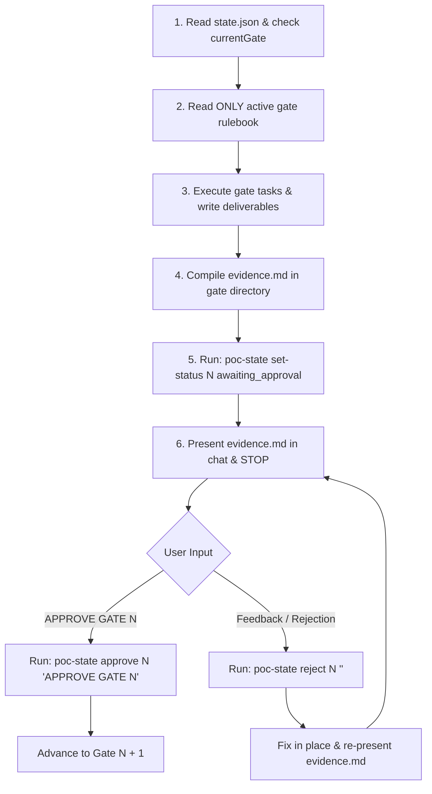

# PoC to Proposal (`poc-to-proposal`)

> [!IMPORTANT]
> **Production Freeze Override:**
> Nothing goes to production, and nothing merges to `main` in `nextwebworks-website` or any live repository, without the relevant gate's explicit human approval.
>
> **Human Approval Barrier:**
> An approval requires the exact verbatim phrase `APPROVE GATE N` typed by the human in chat. Colloquial phrases (such as "looks good", "go ahead", "approved", "proceed") are strictly rejected. Gates cannot be skipped, bypassed, or reordered.
>
> **Progressive Disclosure Invariant:**
> The agent MUST read ONLY the active gate's rulebook. Reading future gate rulebooks eagerly is strictly forbidden to preserve context tokens and enforce gate containment.
>
> **Single Task Scope:**
> This skill governs only the transition of an existing PoC into an executive proposal package. Do not modify unrelated workspace features during this workflow.
>
> **Anti-AI-Slop & Authentic Pattern Reuse Invariant (Gates 4 & 7):**
> All public web deliverables (landing pages and case studies) MUST mirror the target site's established design system, light/dark dual theme, and component patterns. Forced pitch-black backgrounds, neon gradient text, numbered card cliches, generic filler titles, and internal "technical spec sheet" copywriting are strictly forbidden. Copy must focus on client outcomes and executive value.

---

## Overview

This skill guides a finished Proof-of-Concept (PoC) through an eight-stage human-gated checklist. Every gate writes its deliverables into `poc/<project>/gate-N-<gate-name>/` inside the target PoC repository and concludes with an `evidence.md` file and state verification before pausing for explicit human sign-off.

---

## State Machine Helper (`poc-state.mjs`)

Progress is tracked deterministically in `poc/<project>/state.json` using the companion CLI helper.

> [!TIP]
> **Scripts Over Prompts:** Always run `node <path>/poc-state.mjs --help` to inspect CLI commands rather than reading script source files.

### Common Helper Commands

```bash
# Display CLI help and flag usage
node <path-to-skill>/scripts/poc-state.mjs --help

# Initialize state.json for a new PoC project
node <path-to-skill>/scripts/poc-state.mjs init <project>

# Inspect current gate and status summary
node <path-to-skill>/scripts/poc-state.mjs status

# Set gate status (pending | in_progress | awaiting_approval | approved | rejected)
node <path-to-skill>/scripts/poc-state.mjs set-status <N> awaiting_approval

# Approve gate N with exact verbatim phrase (advances currentGate)
node <path-to-skill>/scripts/poc-state.mjs approve <N> "APPROVE GATE N"

# Record rejection feedback from the user
node <path-to-skill>/scripts/poc-state.mjs reject <N> "<feedback reason>"

# Update metadata or URL fields (secrets are blocked)
node <path-to-skill>/scripts/poc-state.mjs set-field nwwWebsiteRepo "/path/to/nextwebworks-website"
node <path-to-skill>/scripts/poc-state.mjs set-field urls.prod "https://my-poc.vercel.app"
```

---

## The Gate Execution Loop

For each gate $N \in [1, 8]$, the agent strictly executes the following cycle:



1. **Read State:** Verify `currentGate` in `poc/<project>/state.json`.
2. **Read Active Rulebook Only:** Open strictly `references/gate-N-<gate-name>/rulebook.md`. Do not open future gates.
3. **Execute Gate Work:** Produce all required deliverables directly inside `poc/<project>/gate-N-<gate-name>/`.
4. **Compile Evidence:** Write `poc/<project>/gate-N-<gate-name>/evidence.md` summarizing verified items.
5. **Set Status:** Execute `node <path>/poc-state.mjs set-status <N> awaiting_approval`.
6. **Stop & Present:** Present the evidence summary and manual checklist in chat, then **STOP CALLING TOOLS**.
7. **Handle Human Response:**
   - If the user types **`APPROVE GATE N`**: Run `node <path>/poc-state.mjs approve <N> "APPROVE GATE N"` and proceed to Gate $N+1$.
   - If the user provides feedback or rejection: Run `node <path>/poc-state.mjs reject <N> "<reason>"`, update the gate's files in place, update `evidence.md`, reset status to `awaiting_approval`, and re-present. Never create duplicate deliverable files.

---

## Codified Human Feedback & Deterministic Execution Rules

Every agent running this skill must execute these exact codified feedback rules deterministically on every run:

### Rule 1: Mandatory Host Repository Rule Compliance (AGENTS.md & .agents/rules)
When generating or modifying code in `nextwebworks-website` (Gates 4 and 7), the agent MUST read and strictly obey that repository's `AGENTS.md` and `.agents/rules/`:
- **Line Ceilings:** Page Server Components (`page.js`) must be strictly $\le 80$ lines of code. Section components must be strictly $\le 250$ lines.
- **Section Contract:** Every modular section component must open with `// section: <id>` on line 1 and render `data-section="<id>"` on its root JSX element.
- **Minimum 5 Body Sections Rule:** Every public page route must compose at least 5 qualifying body sections **excluding** Hero, CTA banners, FAQ accordion, Contact Form, and Footer (`min-sections-per-page.md`).
- **Banned Clichés Enforcement:** Under no circumstances may copy contain prohibited clichés from `copy-standards.md` (`unlock`, `elevate`, `seamless`, `leverage`, `cutting-edge`, `state-of-the-art`, `game-changer`, `revolutionize`, `bespoke`, `tailored solutions`, `supercharge`, `empower`, or "not just X but Y").
- **Decoupled Content:** Decouple static copy and schema arrays into `content.js` or `site/content/`.
- **Pre-Commit Automated Verification:** The agent MUST run `pnpm --dir site check:structure` and `pnpm --dir site lint` in `nextwebworks-website` and verify 0 errors before committing or pushing.

### Rule 2: Anti-AI-Slop Visual Standards
- **FORBIDDEN:** Forced full-screen dark mode (`bg-slate-950`) when the website header is in light mode. Dual light/dark support is mandatory (`bg-white dark:bg-[#0B0F19]`).
- **FORBIDDEN:** Neon gradient text (`bg-gradient-to-r text-transparent bg-clip-text`). Use solid typography (`text-slate-900 dark:text-white` or brand accent `#2563EB`).
- **FORBIDDEN:** Numbered card cliches (`[1]`, `[2]`, `[3]` in colored circles with single-sentence generic fluff).
- **FORBIDDEN:** Generic filler headings ("Enterprise Architectural Pillars", "Cutting-Edge Innovation"). Use specific, high-substance descriptors.
- **FORBIDDEN:** Floating pulsing green dots or radial background glow blurs.
- **FORBIDDEN:** Abstract placeholder graphics. Always show realistic UI representations or mockups of the product in its host environment.

### Rule 3: Client-Facing Value-First Copywriting (No "Spec Sheets")
Public landing pages and case studies are commercial assets, not internal engineering documentation:
- **Lead with Business Outcomes:** Heroes and headline value cards must address executive friction, speed, cost savings, and clarity (e.g. "Eliminate 3-Day Reporting Backlogs", "Ask Questions Directly in Power BI").
- **No Spec-Sheet Jargon in Heroes:** Never pitch internal implementation mechanics (e.g. "streams token deltas", "AST parsing", "50-row bounds") as headline customer benefits.
- **Relocate Technical Credentials:** Security guardrails, AST validation, and API specs belong strictly in dedicated "Enterprise Governance", "How It Works", or "Technical Specifications" sections to build institutional trust.

### Rule 4: Hero Anatomy & Schematic Card (Image 2 Mirror)
- **Left Column:** Eyebrow pill with subtle border and pulsing dot, dual-tone heading (black primary sentence + muted slate secondary sentence), client-facing outcome description, dual CTAs (primary blue button `#2563EB` + disabled secondary button with Gate 5 tooltip), and trust metadata checkmarks row (`✓ Direct DAX Evaluation`, `✓ 100% Read-Only Safety`, etc.).
- **Right Column:** Realistic interactive tilted schematic window card (`MotionTilt`) with macOS red/yellow/green window dots (`#EF4444`, `#F59E0B`, `#10B981`), `*.spec` title, and multi-step connected workflow nodes.

### Rule 5: Vercel Preview Deployment Verification
- Never assume `git push` on a feature branch automatically deploys. Check `npx vercel ls`.
- If git integration does not deploy the branch automatically, execute `npx vercel` (preview deployment, never `--prod`) to generate a fresh preview deployment.
- Record and verify the exact active deployment URL in `state.json` and `evidence.md`. Never link to stale historical deployment hashes.

---

## Gate Directory & Rulebook Pointers

| Gate | Name | Deliverable Directory | Rulebook |
| :---: | :--- | :--- | :--- |
| **1** | **Freeze Scope** | `poc/<project>/gate-1-freeze-scope/` | [Gate 1 Rulebook](references/gate-1-freeze-scope/rulebook.md) |
| **2** | **Manual Test** | `poc/<project>/gate-2-manual-test/` | [Gate 2 Rulebook](references/gate-2-manual-test/rulebook.md) |
| **3** | **Complete & Hosted** | `poc/<project>/gate-3-complete-and-hosted/` | [Gate 3 Rulebook](references/gate-3-complete-and-hosted/rulebook.md) |
| **4** | **Landing Page & Leads** | `poc/<project>/gate-4-landing-page-leads/` | [Gate 4 Rulebook](references/gate-4-landing-page-leads/rulebook.md) |
| **5** | **Demo Subdomain** | `poc/<project>/gate-5-demo-subdomain/` | [Gate 5 Rulebook](references/gate-5-demo-subdomain/rulebook.md) |
| **6** | **Walkthrough Video** | `poc/<project>/gate-6-walkthrough/` | [Gate 6 Rulebook](references/gate-6-walkthrough/rulebook.md) |
| **7** | **Case Study** | `poc/<project>/gate-7-case-study/` | [Gate 7 Rulebook](references/gate-7-case-study/rulebook.md) |
| **8** | **Proposal PDF** | `poc/<project>/gate-8-proposal-pdf/` | [Gate 8 Rulebook](references/gate-8-proposal-pdf/rulebook.md) |
