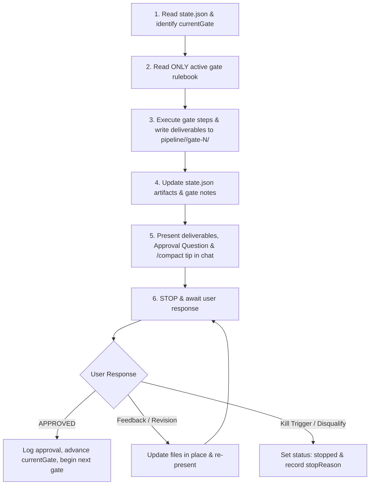

# Sales Pipeline (`sales-pipeline`)

> [!IMPORTANT]
> **Human Approval Barrier:**
> The agent NEVER advances a gate without the exact verbatim approval text: **`APPROVED`**. Silence, colloquial acknowledgments ("ok", "looks good", "go ahead", "proceed"), or ambiguous responses mean stay on the current gate. A rejection preserves state and records human feedback.
>
> **Zero-Send Invariant:**
> The agent drafts and prepares materials, but **NEVER** sends emails, invoices, proposals, or messages, and never contacts or publishes to anyone. The human user reviews, approves, and executes all external sends.
>
> **Strict Anti-Fabrication Rule:**
> Never fabricate facts, benchmarks, performance metrics, prospect firmographics, or testimonials. Every prospect claim must cite an authoritative source or be explicitly marked `[UNVERIFIED]`.
>
> **Universal Kill Criterion:**
> Every gate defines an explicit kill criterion. When triggered, the prospect's status transitions to `"stopped"` with a recorded `stopReason`.
>
> **No CRM Dependency:**
> The local `pipeline/<prospect>/` folder is the primary, zero-dependency source of truth. Optional CRM synchronization remains strictly OFF unless explicitly enabled.
>
> **Universal Context Compaction Rule (`/compact` on Each Gate Transaction):**
> At every gate presentation, rejection pause, human sign-off, or stage transition across the seven-stage pipeline (Gates 1 through 7), the agent MUST instruct and remind the user to trigger `/compact`. This consolidates client notes, qualification matrices, and proposal terms into persistent state files (`state.json`, gate deliverables) and preserves context window headroom for the upcoming gate:
> `> [!TIP]`
> `> **Context Compaction:** You can run \`/compact\` to compact conversation history and maintain context window headroom for Gate N + 1.`

---

## Overview

This skill guides agency client acquisition through seven human-gated stages tailored for Next Web Works agency services (custom web applications, Next.js migrations, paid pilot sprints, and ongoing technical retainers). Every gate writes its deliverables into `pipeline/<prospect>/gate-N/` and requires human approval before advancing.

---

## State Schema (`pipeline/<prospect>/state.json`)

Each prospect is tracked in `pipeline/<prospect>/state.json`. The agent inspects and updates this file using native file editor tools:

```json
{
  "prospect": "<prospect-slug>",
  "company": "<Company Name>",
  "createdAt": "YYYY-MM-DDTHH:mm:ss.sssZ",
  "updatedAt": "YYYY-MM-DDTHH:mm:ss.sssZ",
  "currentGate": 1,
  "status": "active",
  "stopReason": null,
  "serviceInterest": "web-project",
  "crmSync": {
    "enabled": false,
    "provider": null,
    "lastSyncedAt": null
  },
  "approvals": [
    {
      "gate": 1,
      "gateName": "prospecting",
      "timestamp": "YYYY-MM-DDTHH:mm:ss.sssZ",
      "approvalText": "APPROVED",
      "notes": "Shortlist confirmed"
    }
  ],
  "artifacts": {},
  "gates": [
    { "n": 1, "name": "prospecting", "status": "in_progress", "approvedAt": null, "approvalText": null, "outputDir": "pipeline/<prospect>/gate-1/", "notes": null },
    { "n": 2, "name": "outreach", "status": "pending", "approvedAt": null, "approvalText": null, "outputDir": "pipeline/<prospect>/gate-2/", "notes": null },
    { "n": 3, "name": "discovery", "status": "pending", "approvedAt": null, "approvalText": null, "outputDir": "pipeline/<prospect>/gate-3/", "notes": null },
    { "n": 4, "name": "live-poc-demonstration", "status": "pending", "approvedAt": null, "approvalText": null, "outputDir": "pipeline/<prospect>/gate-4/", "notes": null },
    { "n": 5, "name": "pilot-trial", "status": "pending", "approvedAt": null, "approvalText": null, "outputDir": "pipeline/<prospect>/gate-5/", "notes": null },
    { "n": 6, "name": "paid-conversion", "status": "pending", "approvedAt": null, "approvalText": null, "outputDir": "pipeline/<prospect>/gate-6/", "notes": null },
    { "n": 7, "name": "customer-success", "status": "pending", "approvedAt": null, "approvalText": null, "outputDir": "pipeline/<prospect>/gate-7/", "notes": null }
  ]
}
```

### State Rules
1. **Initial State:** On prospect creation, write `state.json` with `currentGate: 1`, Gate 1 `status: "in_progress"`, and Gates 2–7 `status: "pending"`.
2. **Approval Transition:** When the user replies with verbatim **`APPROVED`**:
   - Log an entry into `approvals` array with the timestamp and approval text.
   - Set current gate `status: "approved"` and set `approvedAt`.
   - Increment `currentGate` to $N + 1$ (if $N < 7$) and set Gate $N+1$ `status: "in_progress"`.
   - Remind the user to trigger `/compact` to preserve context window availability.
   - When Gate 7 is approved, transition top-level `status` to `"converted"`.
3. **Kill Transition:** If a gate's kill criterion is met or the human decides to drop the lead:
   - Set top-level `status: "stopped"`.
   - Set current gate `status: "stopped"`.
   - Record explanation in `stopReason`.
4. **Rejection / Revision:** If the human provides revision feedback without "APPROVED", keep `currentGate` unchanged, update deliverable files in place, and await approval.

---

## Gate Execution Protocol



---

## Optional Skill Integration

Where installed in the environment, the skill enhances execution by referencing specialized skills. **The pipeline operates 100% standalone if none are present:**

| Gate | Stage | Optional Enhancer Skills |
| :---: | :--- | :--- |
| **1** | Prospecting | `account-research`, `lead-triage` |
| **2** | Outreach | `draft-outreach`, `email-sequence`, `brand-review` |
| **3** | Discovery | `call-prep`, `call-summary`, `handle-objection` |
| **4** | Live PoC Demo | **`poc-to-proposal`** *(Mandatory delegation for technical build)* |
| **5** | Pilot-Trial | `handle-objection` |
| **6** | Paid Conversion | `close-plan` |
| **7** | Customer Success | `customer-health`, `renewal-radar`, `expansion-whitespace` |

---

## Gate Directory & Rulebook Pointers

| Gate | Name | Deliverable Directory | Rulebook |
| :---: | :--- | :--- | :--- |
| **1** | **Prospecting** | `pipeline/<prospect>/gate-1/` | [Gate 1 Rulebook](references/gate-1-prospecting/rulebook.md) |
| **2** | **Outreach** | `pipeline/<prospect>/gate-2/` | [Gate 2 Rulebook](references/gate-2-outreach/rulebook.md) |
| **3** | **Discovery** | `pipeline/<prospect>/gate-3/` | [Gate 3 Rulebook](references/gate-3-discovery/rulebook.md) |
| **4** | **Live PoC Demo** | `pipeline/<prospect>/gate-4/` | [Gate 4 Rulebook](references/gate-4-live-poc-demonstration/rulebook.md) |
| **5** | **Pilot-Trial** | `pipeline/<prospect>/gate-5/` | [Gate 5 Rulebook](references/gate-5-pilot-trial/rulebook.md) |
| **6** | **Paid Conversion** | `pipeline/<prospect>/gate-6/` | [Gate 6 Rulebook](references/gate-6-paid-conversion/rulebook.md) |
| **7** | **Customer Success** | `pipeline/<prospect>/gate-7/` | [Gate 7 Rulebook](references/gate-7-customer-success/rulebook.md) |
